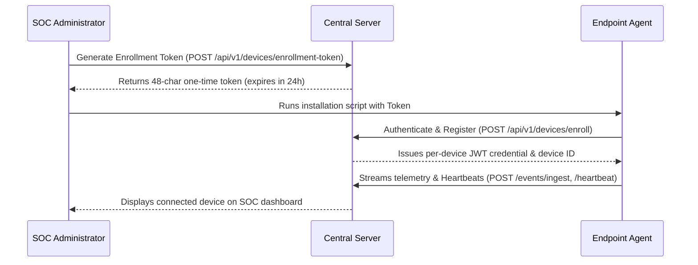

# SecureWatch Endpoint Agent Enrollment Guide

## 1. Overview
The SecureWatch Endpoint Agent runs as a transparent, authorized background service on authorized endpoint devices. It strictly collects security telemetry (auth, processes, network connections, FIM, security posture) and never captures private documents, passwords, or keystrokes.

---

## 2. Enrollment Workflow



---

## 3. Windows 10/11 Installation
1. Open PowerShell as **Administrator**.
2. Run the automated installer:
   ```powershell
   cd d:\DHANUZ\Apps\Antigravity\endpoint-agent\installers\windows
   .\install.ps1 -ServerUrl "http://localhost:8000" -EnrollmentToken "<YOUR_TOKEN>"
   ```
3. Verify status:
   ```powershell
   python main.py --status
   ```

---

## 4. Linux Installation (Ubuntu / Debian / Kali)
1. Run as root:
   ```bash
   cd /path/to/endpoint-agent/installers/linux
   sudo chmod +x install.sh
   sudo ./install.sh
   ```
2. Verify systemd service:
   ```bash
   sudo systemctl status securewatch-agent
   ```

---

## 5. Uninstallation Process
To completely remove the agent:
- **Windows:** Run `.\uninstall.ps1` as Administrator.
- **Linux:** Run `sudo ./uninstall.sh`.
